> [!IMPORTANT]
> **Aviso Institucional Obrigatório:** Projeto independente, educacional e demonstrativo, desenvolvido como estudo de Dados e Automação. Não constitui solução oficial, homologada ou implantada por instituição financeira ou pela Microsoft. Os dados utilizados nas demonstrações são fictícios. As telas da Power Platform são representações ilustrativas.

# Case de Dados e Automação — Alteração de Beneficiários em Seguros PF
### Do diagnóstico operacional a uma proposta rastreável de automação, com protótipo funcional e arquitetura corporativa de referência.

---

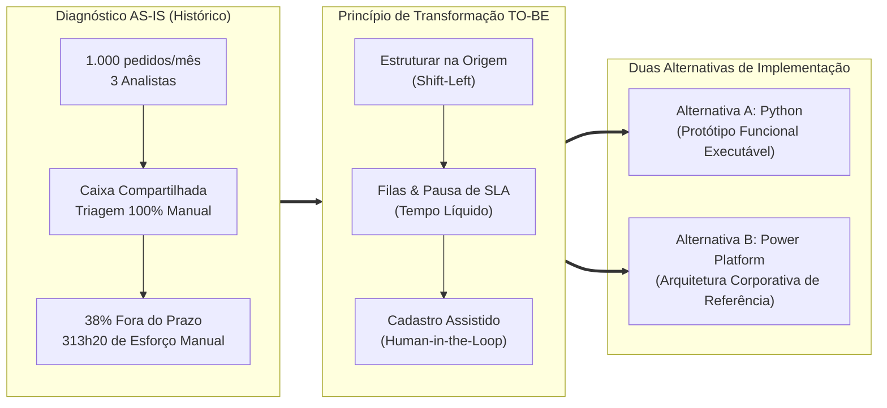

---

## 1. Resumo Executivo

O processo de alteração de beneficiários em apólices de seguros de pessoas físicas (PF) é uma operação com impacto direto sobre direitos sucessórios e securitários. Historicamente, essa esteira opera de forma analógica e descentralizada: pedidos chegam por e-mails com redações livres, formulários escaneados em agências e cargas parciais de aplicativo, convergindo todos para uma única caixa postal compartilhada.

O resultado é um cenário crônico de sobrecarga operacional: **38% das solicitações estouram o SLA de 5 dias**, enquanto **313,33 horas mensais de trabalho humano** são consumidas em conferências repetitivas e cobranças manuais de documentos que faltam.

Este projeto apresenta a consolidação completa da transformação desse processo:
1. **Diagnóstico aprofundado dos gargalos operacionais e análise de tempos e métodos**;
2. **Proposta TO-BE padronizada em 11 etapas**, baseada no princípio de que *“antes de automatizar, é necessário estruturar, controlar e tornar o processo rastreável”*;
3. **Duas alternativas de implementação independentes e completas**:
   - **Alternativa A (Pro-Code):** Protótipo funcional desenvolvido em **Python, Streamlit e SQLite**, com laboratório de simulação em lote e 35 testes automatizados.
   - **Alternativa B (Low-Code):** Arquitetura corporativa de referência desenhada para o ecossistema **Microsoft Power Platform** (Dataverse com 19 entidades, 9 cloud flows no Power Automate, SharePoint, Power BI e 8 mockups funcionais).

---

## 2. O Desafio em Números

O dimensionamento da operação baseia-se nos dados consolidados do case:

| Indicador Operacional | Valor Histórico | Impacto no Processo |
|---|---|---|
| **Volume Mensal** | **1.000 solicitações** | Demanda regular processada pela célula de seguros |
| **Equipe Operacional** | **3 analistas** | Força de trabalho dedicada (capacidade nominal de ~480 h/mês) |
| **Crescimento Projetado** | **10% ao ano** | Pressão por escalabilidade sem aumento linear de headcount |
| **SLA Interno** | **5 dias corridos/úteis** | Acordo regulatório e de satisfação do cliente |
| **Cumprimento de SLA** | **62% no prazo / 38% atrasadas** | Mais de 380 clientes com atendimento fora do prazo mensalmente |
| **Inadequação Documental Inicial** | **~25% (250 casos/mês)** | Solicitações com documentos ausentes, ilegíveis ou incompletos |
| **Espera por Complemento** | **100 casos/mês** | Saldo médio de solicitações paradas aguardando resposta do segurado |
| **Esforço Humano Ativo Estimado** | **313h20 (313,33 h/mês)** | Esforço direto em triagem, conferência, cadastro e respostas |

> [!NOTE]
> Os 25% de inadequação na entrada e as 100 solicitações em espera prolongada por complemento são populações relacionadas, mas com dinâmicas diferentes. A documentação não atribui a totalidade dos 38% de atraso exclusivamente à falta de documentação do segurado, reconhecendo que concorrência de fila interna e tempo de triagem manual também impactam o prazo final.

---

## 3. Três Gargalos Principais

A análise diagnóstica identificou três restrições estruturais que explicam as falhas operacionais:

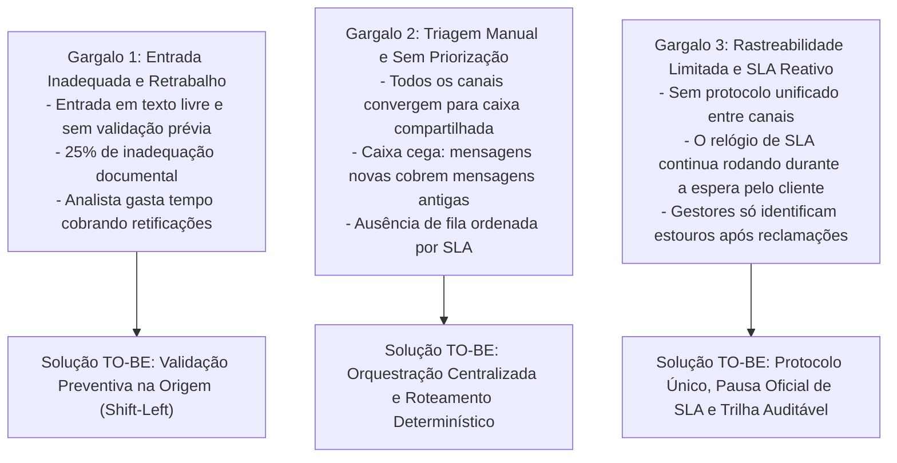

- **Gargalos Secundários Identificados:** Comunicação dispersa sem modelo padronizado, controle puramente reativo de prazos, alta dependência de digitação manual nos sistemas core e baixa capacidade de absorver novos volumes sem inflar a equipe.

---

## 4. Comparativo de Processo: AS-IS vs TO-BE

### O Fluxo Histórico (AS-IS)
Processo linear manual, sem validação algorítmica na origem e com SLA correndo ininterruptamente:

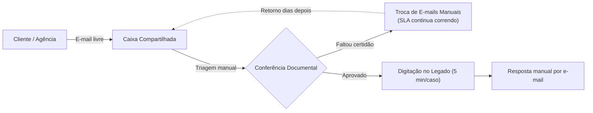

### O Fluxo Proposto (TO-BE em 11 Etapas)
Processo estruturado, com validações na entrada, roteamento automático e preservação do julgamento humano:

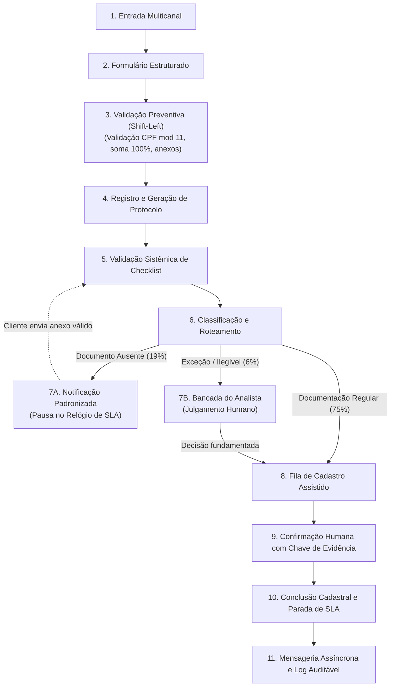

---

## 5. Um Mesmo TO-BE. Duas Alternativas de Implementação.

O TO-BE aprovado foi materializado em duas soluções tecnológicas complementares e independentes:

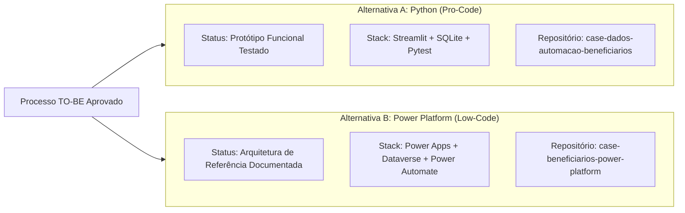

---

### Alternativa A — Python (Pro-Code)
> **Protótipo funcional executável desenvolvido para provar empiricamente as regras de negócio, a máquina de estados e o comportamento estatístico sob carga de 1.000 solicitações.**

- **Acesse o Repositório Oficial:** [github.com/pedro-caputo/case-dados-automacao-beneficiarios](https://github.com/pedro-caputo/case-dados-automacao-beneficiarios)
- **Tecnologias Utilizadas:** Python 3.14, Streamlit (UI), SQLite (banco relacional local), Pandas e Pytest (35 testes aprovados).
- **Recursos Chave:** Formulário com validação algorítmica na origem, gestão de filas priorizadas por SLA, Bancada do Analista para decisões fundamentadas, controle de tempo líquido com pausas registradas e Laboratório Experimental em lote.
- **Fronteira e Limitação:** Opera em banco local demonstrativo; a efetivação cadastral é validada e registrada internamente sem conexão real a barramentos de mainframe legado.

#### Galeria do Protótipo Python:
| Nova Solicitação (Validação na Origem) | Bancada do Analista (Decisão Humana) |
|---|---|
| 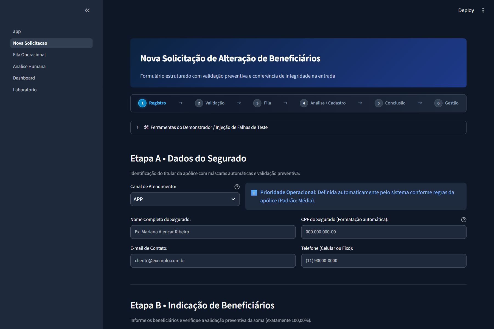 | 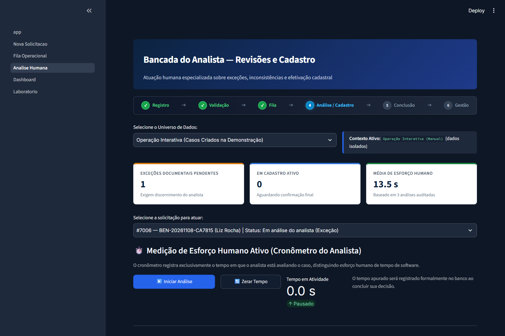 |

| Fila Operacional com SLA | Laboratório de Simulação Sintética |
|---|---|
| 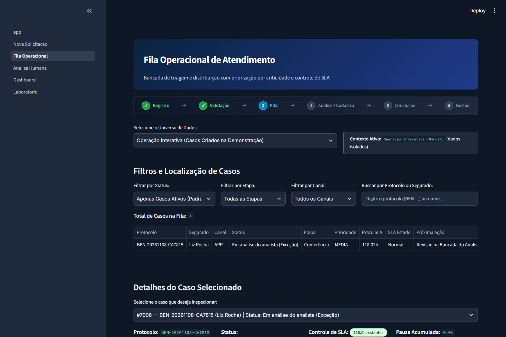 | 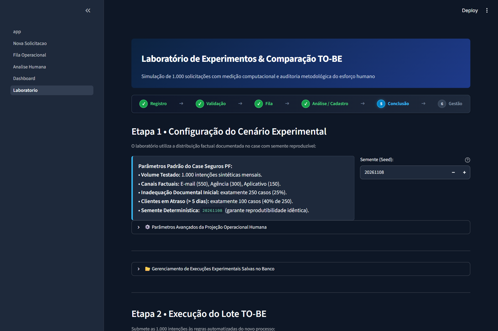 |

---

### Alternativa B — Microsoft Power Platform (Low-Code)
> **Arquitetura corporativa de referência desenvolvida para grandes instituições que adotam o ecossistema Microsoft 365, com foco em governança de dados, conformidade e integração corporativa.**

- **Acesse o Repositório Oficial:** [github.com/pedro-caputo/case-beneficiarios-power-platform](https://github.com/pedro-caputo/case-beneficiarios-power-platform)
- **Tecnologias Especificadas:** Power Apps (Model-Driven App), Microsoft Dataverse (19 tabelas `bpf_*`), Power Automate (9 cloud flows), SharePoint Online e Power BI.
- **Recursos Chave:** Matriz de segurança baseada em funções (RBAC) integrada ao Entra ID, padrão Outbox para desacoplamento de transações, custódia estruturada de arquivos em SharePoint e observabilidade executiva via Power BI.
- **Fronteira e Limitação:** Trata-se de uma especificação arquitetural de engenharia respaldada por 8 mockups funcionais e documentação técnica detalhada; não há componentes implantados em tenant corporativo real.

#### Galeria de Mockups da Power Platform:
| Power Apps — Bancada do Analista | Microsoft Dataverse — Modelo 19 Tabelas |
|---|---|
| 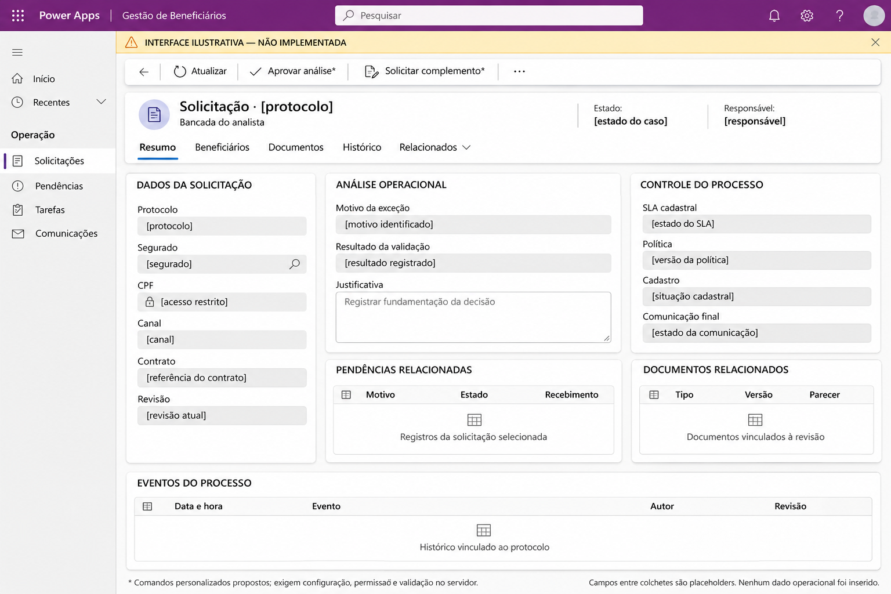 | 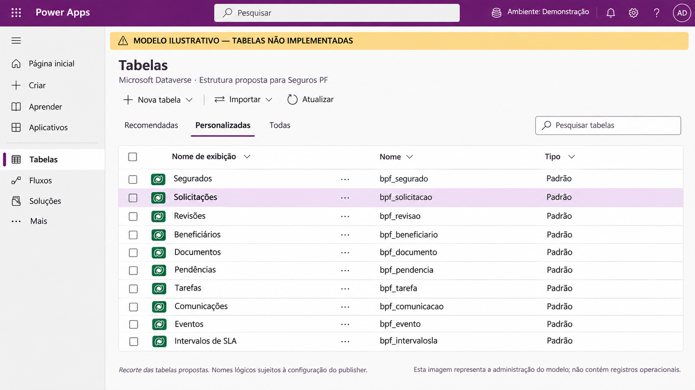 |

| Power Automate — Notificação de Complemento | Power BI — Observabilidade do Processo |
|---|---|
| 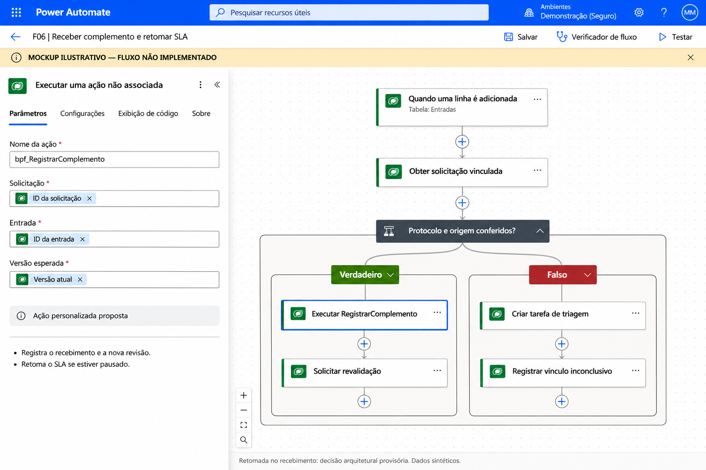 | 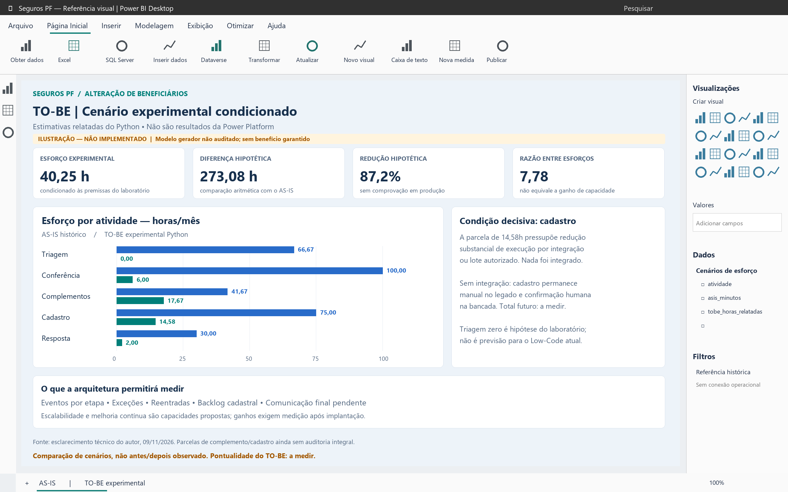 |

---

### Quadro Comparativo Direto:

| Critério | Alternativa A — Python (Pro-Code) | Alternativa B — Power Platform (Low-Code) |
|---|---|---|
| **Papel no Projeto** | Protótipo funcional executável e testado | Arquitetura corporativa de referência documentada |
| **Demonstração Prática** | Aplicação web interativa navegável localmente | 8 mockups conceituais ilustrativos e fluxos detalhados |
| **Camada de Dados** | SQLite com DDL relacional e integridade referencial | Microsoft Dataverse com 19 entidades `bpf_*` normalizadas |
| **Governança e Perfis** | Validações em código e isolamento de universos | Matriz de segurança nativa Microsoft (RBAC / Entra ID) |
| **Custo de Licenciamento** | Tecnologias de código aberto (sem custo de licença) | Licenciamento corporativo Microsoft (Power Apps / Dataverse) |
| **Extensibilidade** | Evolução para microsserviços containerizados | Evolução gerenciada através de Solutions M365 corporativas |

---

## 6. O Que Foi Demonstrado Empiricamente

No protótipo funcional em Python (`Alternativa A`), foram consolidadas evidências concretas:

### 6.1 Rodada Interativa (3 Casos Ponta a Ponta)
- **3 solicitações criadas** em ambiente interativo;
- **2 solicitações concluídas** após validação e confirmação com chave de evidência cadastral;
- **1 solicitação encaminhada para a Bancada do Analista** devido a inconsistência documental.

### 6.2 Laboratório Experimental (Lote de 1.000 Casos Sintéticos)
Execução determinística com semente estatística controlada (`seed = 20261108`):
- **1.000 intenções avaliadas:** 550 por E-mail, 300 por Agência e 150 pelo Aplicativo;
- **750 casos (75,0%):** Aptos para Cadastro direto (*Straight-Through Processing Assistido*);
- **190 casos (19,0%):** Classificados como *Aguardando Complemento* (com pausa automática de SLA);
- **60 casos (6,0%):** Encaminhados como *Exceções para a Bancada do Analista*.
- *(Soma exata das categorias do lote: $750 + 190 + 60 = 1.000$ casos)*.

### 6.3 Indicador Adicional: 77 Erros Prevenidos na Entrada
- **77 erros de digitação e inconsistência** (CPFs inválidos no módulo 11, quotas somando valores diferentes de 100%, e-mails incorretos) foram interceptados preventivamente na submissão pelo formulário.
- *(Este indicador mede erros evitados na entrada e não constitui uma quarta categoria no lote de 1.000).*

### 6.4 Desempenho Computacional: 0,221 Segundo
- O motor de validação local processou em CPU as 1.000 intenções, validou schemas e persistiu os dados em **0,221 segundo** (~4.534 registros/segundo).
- *(Ressalva: Mede capacidade de processamento algorítmico da CPU em disco local, não significando atendimento de clientes em 0,221s).*

---

## 7. Resultados de Esforço Operacional e Ressalvas

### Quanto Esforço Podemos Evitar — e Sob Quais Premissas?
A modelagem comparou o esforço humano direto mensal documentado no processo histórico com a projeção resultante do cenário experimental:

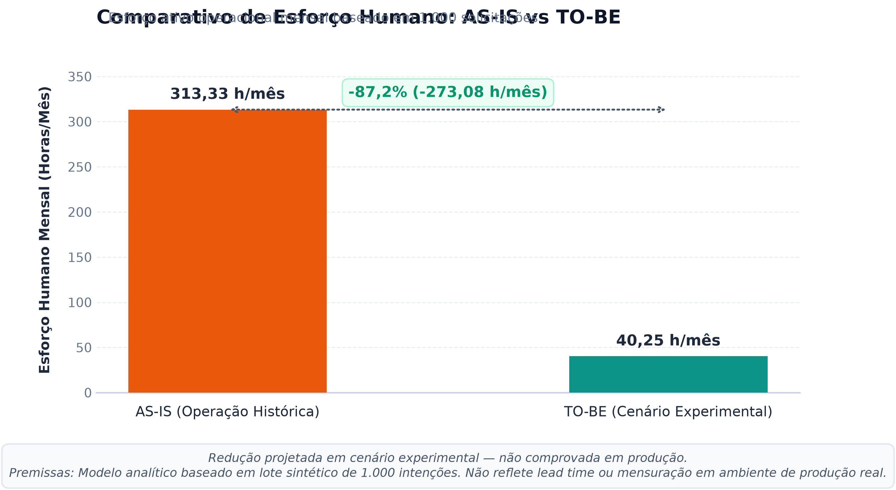

| Cenário Analisado | Esforço Ativo Humano Mensal | Redução em Horas | Variação Percentual |
|---|---|---|---|
| **AS-IS Histórico** | **313,33 horas/mês** (313h20) | Baseline oficial | — |
| **TO-BE Experimental** | **40,25 horas/mês** (40h15) | **-273,08 horas/mês** | **-87,2%** |

> [!WARNING]
> **Ressalvas Metodológicas Obrigatórias:**
> 1. A redução de **87,2%** é uma **projeção analítica baseada no cenário experimental da solução Python**, e **não um resultado medido em ambiente corporativo de produção**.
> 2. As premissas de tempo residual (2 min por cadastro assistido e 15 min por exceção humana) demandam calibração empírica através de estudo de tempos e métodos (*time study*) em piloto operacional real.
> 3. O cadastro não foi conectado automaticamente ao mainframe legado de seguros.
> 4. Não há comprovação matemática de que a redução de esforço garanta, isoladamente, 100% de cumprimento de SLA, visto que o tempo de resposta do cliente em casos pendentes afeta o lead time global.
> 5. Os 87,2% não são resultados da Power Platform.

---

## 8. Governança, Papel Humano e Limitações

### O Papel Humano Indispensável (*Human-in-the-Loop*)
A solução rejeita explicitamente a ideia de automação integral não supervisionada. O analista humano permanece insubstituível em:
- Avaliação de certidões e comprovantes de legibilidade inconclusiva;
- Decisão em exceções de representação legal (tutelas, curatelas e procurações);
- Rejeições justificadas e pedidos de complementação formal;
- Efetivação e conferência do cadastro no sistema legado de apólices.

### Políticas Corporativas Pendentes de Homologação Formal:
Antes de avançar para produção, as seguintes definições de governança devem ser formalizadas pelo Jurídico e Produtos:
- **P01:** Política de composição (envio obrigatório da lista integral vs inclusão/exclusão pontual);
- **P02:** Critérios de validação cadastral da apólice em tempo real;
- **P03:** Calendário oficial de contagem de SLA (dias úteis com corte de horário vs dias corridos);
- **P04:** Checklist oficial de documentação exigível por vínculo familiar;
- **P05:** Marco formal de pausa e retomada de contagem regulatória;
- **P06:** Política de cancelamento de solicitações por inércia prolongada do cliente;
- **P07:** Tabela de temporalidade e expurgo documental (LGPD).

---

## 9. Próximos Passos Recomendados

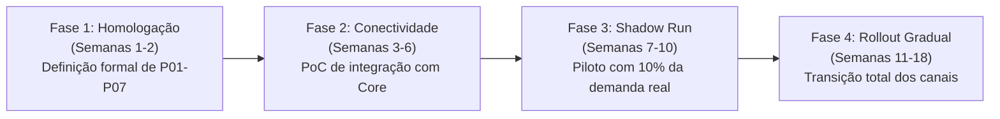

---

## 10. Documentação Consolidada do Projeto

Aprofunde-se nos detalhes de cada dimensão do projeto através dos cadernos de documentação técnica:

| Caderno | Documento | Conteúdo Principal |
|---|---|---|
| **01** | [Case Brief Executivo](docs/01-case-brief.md) | Síntese executiva densa para gestores e liderança de operações |
| **02** | [Diagnóstico AS-IS](docs/02-diagnostico-as-is.md) | Panorama histórico, três gargalos e decomposição detalhada das 313h20 de esforço |
| **03** | [Proposta TO-BE](docs/03-proposta-to-be.md) | Mapeamento das 11 etapas, 3 caminhos e política formal de pausas de SLA |
| **04** | [Alternativas Tecnológicas](docs/04-alternativas-tecnologicas.md) | Comparativo aprofundado entre Python (Pro-Code) e Power Platform (Low-Code) |
| **05** | [Resultados e Metodologia](docs/05-resultados-e-metodologia.md) | Métricas do lote de 1.000 casos, 77 erros prevenidos e ressalvas metodológicas |
| **06** | [Riscos e Próximos Passos](docs/06-riscos-e-proximos-passos.md) | Matriz de riscos, pendências de governança P01-P07 e roadmap de implantação |
| **07** | [Guia de Apresentação](docs/07-guia-de-apresentacao.md) | Roteiro de 11 slides para entrevista e 12 perguntas difíceis com respostas defensáveis |
| **08** | [Fontes e Rastreabilidade](docs/08-fontes-e-rastreabilidade.md) | Matriz de rastreabilidade de dados, links oficiais e resolução de divergências |
| **Auditoria** | [Documentação e Validação](DOCUMENTACAO_E_VALIDACAO.md) | Relatório formal de auditoria técnica pré-publicação |

---

## 11. Links Oficiais dos Repositórios Integrados

- **Repositório Central (Este Portal):** [https://github.com/pedro-caputo/case-beneficiarios-visao-geral](https://github.com/pedro-caputo/case-beneficiarios-visao-geral)
- **Alternativa A — Python (Protótipo Funcional):** [https://github.com/pedro-caputo/case-dados-automacao-beneficiarios](https://github.com/pedro-caputo/case-dados-automacao-beneficiarios)
- **Alternativa B — Power Platform (Arquitetura de Referência):** [https://github.com/pedro-caputo/case-beneficiarios-power-platform](https://github.com/pedro-caputo/case-beneficiarios-power-platform)
