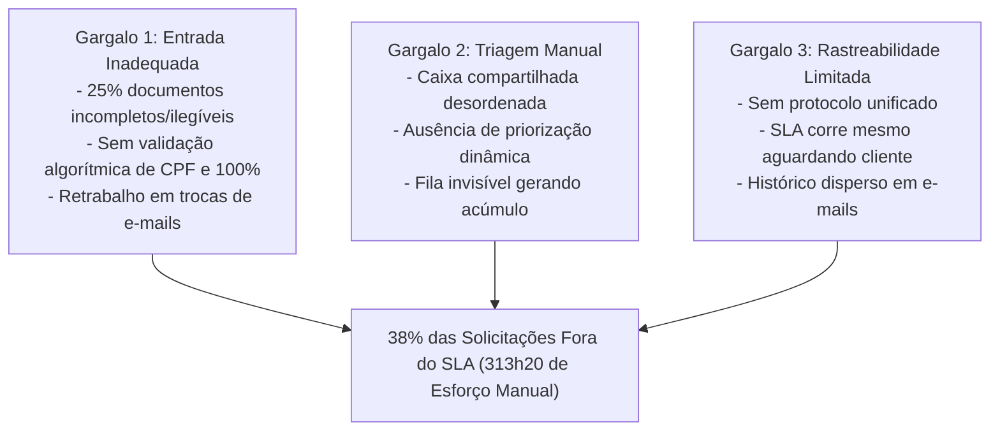
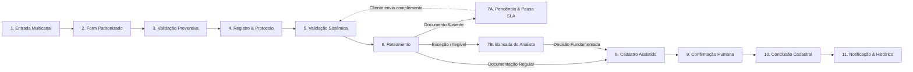

# Case Brief Executivo — Alteração de Beneficiários em Seguros PF

> [!IMPORTANT]
> **Aviso Institucional:** Projeto independente, educacional e demonstrativo, desenvolvido como estudo de Dados e Automação. Não constitui solução oficial, homologada ou implantada por instituição financeira ou pela Microsoft. Todos os dados demonstrativos e resultados são provenientes de modelagem sintética controlada.

---

## 1. Contexto Executivo

O processo de alteração de beneficiários em apólices de seguros de pessoas físicas (PF) constitui uma operação sensível e crítica para a seguradora. Trata-se de um ato jurídico que define os destinatários legais de indenizações securitárias em caso de sinistro, exigindo conformidade regulatória, integridade cadastral e rigorosa rastreabilidade.

### Panorama Operacional Histórico:
- **Demanda Mensal:** 1.000 solicitações/mês.
- **Força de Trabalho Alocada:** 3 analistas de operações dedicados.
- **Crescimento Projetado da Demanda:** 10% ao ano.
- **Acordo de Nível de Serviço (SLA Interno):** 5 dias úteis/corridos.
- **Desempenho Histórico de Entrega:** 62% das solicitações cumpridas no prazo e **38% fora do prazo (em atraso)**.
- **Canais de Entrada:**
  - **E-mail (Caixa Compartilhada):** 55% (550 solicitações/mês).
  - **Agência (Formulários/Malote Digital):** 30% (300 solicitações/mês).
  - **Aplicativo Mobile (Entrada Avulsa):** 15% (150 solicitações/mês).

Atualmente, todos os canais convergem operacionalmente para uma **caixa postal compartilhada de e-mails**, sobrecarregando a equipe com triagens manuais de anexos, mensagens descentralizadas e ausência de fila estruturada.

---

## 2. Problema de Negócio

A operação convive com um descompasso estrutural entre o volume de trabalho e a capacidade de entrega qualificada. A taxa de **38% de solicitações fora do prazo** compromete a experiência do segurado, gera atritos com a rede de distribuição e sobrecarrega canais de atendimento e ouvidoria.

A causa desse cenário não decorre de deficiência individual da equipe, mas da vulnerabilidade do desenho operacional:
1. **Entrada Desestruturada:** Recebimento de mensagens em texto livre, formulários escaneados sem crítica prévia e documentos anexados em baixa resolução.
2. **Triagem Artesanal:** Leitura individual de e-mails e abertura de anexos para identificar apólice, titular e intenção.
3. **Retrabalho Crônico:** Solicitações incompletas exigem reiteradas trocas de mensagens manuais para obtenção de documentos complementares.
4. **Opacidade Operacional:** Inexistência de um relógio de SLA unificado, ausência de pausas formais quando o processo aguarda o segurado e falta de histórico auditável de eventos.

---

## 3. Indicadores Operacionais Relevantes

Com base no levantamento factual do processo:

| Indicador | Valor Histórico | Contexto Operacional |
|---|---|---|
| **Volume Total Mensal** | 1.000 solicitações | Base regular de atendimento da célula de seguros PF |
| **Inadequação Documental Inicial** | ~25% (250 casos/mês) | Solicitações com ausência de documentos ou falhas de legibilidade na entrada |
| **Espera por Complemento** | 100 casos/mês | Solicitações que permanecem represadas aguardando resposta do segurado |
| **Esforço Humano Ativo Estimado** | 313h20 (313,33 horas/mês) | Tempo direto de analista consumido em triagem, conferência, cadastro e respostas |
| **Capacidade Efetiva da Equipe (3 analistas)** | ~480 horas/mês nominais | A operação consome mais de 65% da capacidade total da célula em trabalho manual repetitivo |

> [!NOTE]
> Os 25% de inadequação documental inicial (250 casos) e as 100 solicitações em espera prolongada por complemento são populações correlacionadas, porém distintas. A documentação registra que o tempo de espera do cliente não deve ser tratado como causalidade exclusiva dos atrasos gerais, visto que concorrência de fila e tempo de processamento interno também impactam o lead time.

---

## 4. Diagnóstico AS-IS: Os Três Gargalos Críticos



1. **Gargalo 1 — Entrada Inadequada e Retrabalho:**
   A ausência de crítica digital na origem permite que erros básicos (CPF inválido, soma de beneficiários diferente de 100%, certidões ilegíveis) ingressem no fluxo operacional, transformando o analista em conferente de digitação.

2. **Gargalo 2 — Triagem Manual e Ausência de Priorização:**
   A convergência para e-mail compartilhado gera filas operacionais "cegas". Casos urgentes, casos regulares prontos e casos pendentes competem pela mesma atenção, sem roteamento automatizado.

3. **Gargalo 3 — Rastreabilidade Limitada e SLA Reativo:**
   Não há registro central de transições de estado. O relógio de SLA continua rodando enquanto a seguradora aguarda documentação do cliente, distorcendo a métrica de eficiência interna.

---

## 5. Diretrizes da Solução TO-BE

A modernização proposta apoia-se em um princípio fundamental de engenharia de processos:

> **"Antes de automatizar, é necessário estruturar, controlar e tornar o processo rastreável."**

### Diretrizes Centrais:
- **Shift-Left (Crítica na Origem):** Bloquear inconsistências cadastrais e matemáticas antes da transmissão da solicitação.
- **Roteamento Inteligente (STP vs Exceção):** Encaminhar solicitações completas diretamente para cadastro assistido, reservando a capacidade analítica humana para exceções de negócio e conferências complexas.
- **Controle Transacional de SLA:** Implementar relógio com medição líquida de tempo de atendimento, pausando o cômputo regulatório durante o período de pendência atribuível ao segurado.
- **Histórico Append-Only:** Garantir que todo evento, envio de notificação, transição de estado e intervenção humana possua registro auditável imutável.

---

## 6. Proposta de Processo TO-BE

O novo fluxo operacional estrutura-se em **11 etapas orquestradas**:



### Caminhos Operacionais Mapeados:
- **Fluxo Regular (STP Assistido):** Dados íntegros → Validação aprovada → Pronta para cadastro → Confirmação humana com registro de evidência → Conclusão.
- **Exceção Documental:** Ilegibilidade ou dúvida de negócio → Bancada do Analista → Análise detalhada → Decisão humana fundamentada (deferimento ou indeferimento).
- **Pendência de Complemento:** Documento obrigatório ausente → Solicitação automática padronizada ao cliente → Pausa do SLA → Retomada no recebimento identificável → Revalidação.

---

## 7. O Papel Humano no TO-BE

A proposta **não é uma automação integral sem pessoas (*full no-human automation*)**. O processo securitário envolve responsabilidade civil e jurídica.

O analista deixa de ser um digitador de formulários e atua como tomador de decisão especializado:
- Avaliação de certidões e comprovantes em casos de legibilidade limítrofe.
- Análise de exceções de parentesco ou representação legal por procuração/tutela.
- Decisão sobre pedidos de alteração contestados ou em análise de compliance.
- Efetivação do cadastro com verificação assistida no sistema core e registro da chave de evidência.

---

## 8. Duas Alternativas Tecnológicas Independentes

Para materializar o mesmo fluxo TO-BE aprovado, foram desenvolvidas e documentadas duas abordagens tecnológicas complementares e independentes:

| Dimensão | Alternativa A — Python (Pro-Code) | Alternativa B — Power Platform (Low-Code) |
|---|---|---|
| **Posicionamento** | **Protótipo Funcional Implementado e Testado** | **Arquitetura Corporativa de Referência** |
| **Tecnologias** | Python 3, Streamlit, SQLite, Pandas, Pytest | Power Apps Model-Driven, Dataverse, Power Automate, SharePoint, Power BI |
| **Objetivo** | Provar empiricamente as regras de negócio, a lógica de triagem e a mensuração de esforço em ambiente controlado | Desenhar a estrutura corporativa pronta para governança, segurança integrada (RBAC/M365) e implantação corporativa |
| **Evidência Entregue** | Sistema web funcional executável, banco relacional com dados sintéticos, laboratório de simulação e 35 testes automatizados | Modelo relacional de 19 tabelas, 9 fluxos de orquestração detalhados, matriz de segurança e 8 mockups funcionais |
| **Repositório** | [case-dados-automacao-beneficiarios](https://github.com/pedro-caputo/case-dados-automacao-beneficiarios) | [case-beneficiarios-power-platform](https://github.com/pedro-caputo/case-beneficiarios-power-platform) |
| **Limitação Atual** | Ambiente demonstrativo; sem barramento conectado ao mainframe legado | Documentação técnica e mockups conceituais; sem tenant M365 provisionado |

---

## 9. Resultados Demonstrados no Protótipo Python

No ambiente do protótipo Python (`Alternativa A`), foram executados testes com dupla modalidade:

### 9.1 Operação Interativa (Ciclo de Vida Individual)
- 3 solicitações interativas processadas de ponta a ponta.
- 2 solicitações concluídas com sucesso através da bancada com evidência registrada.
- 1 solicitação roteada para a Bancada do Analista devido a inconformidade documental.
- Comprovação da máquina de estados, persistência no SQLite e isolamento de universos de dados.

### 9.2 Laboratório Experimental (Simulação em Lote de 1.000 Casos)
Com semente pseudoaleatória controlada (`seed = 20261108`) reproduzindo rigorosamente os parâmetros do case:
- **Total de Intenções Sintéticas Avaliadas:** 1.000 casos (550 E-mail, 300 Agência, 150 App).
- **Aptas para Cadastro Direto (STP Assistido):** **750 casos (75,0%)**.
- **Aguardando Complemento (Documento Ausente):** **190 casos (19,0%)** — SLA pausado automaticamente.
- **Exceções Encaminhadas para a Bancada do Analista:** **60 casos (6,0%)**.
- *(Soma exata das categorias: 750 + 190 + 60 = 1.000 casos)*.

### 9.3 Indicador Adicional de Qualidade na Origem:
- **77 erros sintéticos prevenidos na entrada:** Interceptações imediatas de dígitos verificadores de CPF inconsistentes, soma percentual divergente de 100% e e-mails mal formatados.
- *(Este indicador mede erros evitados na submissão, não sendo uma quarta categoria do lote de 1.000).*

### 9.4 Desempenho Computacional do Motor de Regras:
- **0,221 segundo** para processar localmente em CPU as 1.000 intenções, aplicar regras de negócio e persistir o lote no banco de dados local (~4.534 registros/segundo).
- *(Nota técnica: Mede processamento algorítmico, não significando tempo de ciclo do cliente).*

---

## 10. Projeções de Esforço Operacional e Ressalvas Metodológicas

### Comparativo de Esforço Ativo Humano Mensal:
- **Esforço Histórico AS-IS:** **313,33 horas/mês** (18.800 minutos).
- **Esforço Modelado no TO-BE Experimental:** **40,25 horas/mês** (2.415 minutos).
  - *Composição TO-BE:* 60 exceções x 15 min (15,0h) + 750 cadastros assistidos x 2 min (25,0h) + 15 min residuais de auditoria (0,25h).
- **Diferença Projetada:** **273,08 horas/mês evitadas**.
- **Redução Percentual Modelada:** **-87,2%**.

```
ESFORÇO HUMANO MENSAL (HORAS/MÊS)
AS-IS:          [████████████████████████████████] 313,33 h/mês
TO-BE (Exp.):   [████] 40,25 h/mês (-87,2%)
```

> [!WARNING]
> **Ressalvas Metodológicas Obrigatórias:**
> 1. A redução de 87,2% é uma **projeção analítica baseada no cenário experimental da solução Python**, e **não um resultado medido em produção**.
> 2. As premissas de esforço unitário residual (ex: 2 minutos por cadastro assistido) demandam validação em estudo de tempos e métodos (*time-and-motion*) em ambiente real de produção.
> 3. Não há comprovação estatística direta de que a redução de esforço garanta, por si só, o cumprimento de 100% do SLA, visto que fatores externos e picos de demanda influenciam o atendimento.
> 4. O resultado de 87,2% não é métrica de desempenho da Power Platform, mas do modelo lógico do TO-BE testado no laboratório Python.

---

## 11. Benefícios Estratégicos Esperados

1. **Alívio da Célula Operacional:** Liberação estimada de mais de 270 horas mensais de analistas para atividades analíticas, prevenção a fraudes e auditoria de apólices complexas.
2. **Previsibilidade e Transparência:** Gestão visual das filas por criticidade de SLA e estados de atendimento.
3. **Segurança Jurídica:** Registro histórico append-only garantindo rastreabilidade perante auditorias internas e regulatórias (SUSEP).
4. **Respeito aos Direitos do Segurado:** Pausa oficial do SLA com comunicação padronizada em pendências, evitando distorções no índice de atendimento.

---

## 12. Riscos, Premissas e Dependências

| Categoria | Descrição do Risco / Premissa | Ação Mitigadora Proposta |
|---|---|---|
| **Integração Legado** | Inexistência atual de barramento de integração com o core de seguros | Adoção da fase de *Cadastro Assistido*, mantendo confirmação humana com registro de evidência até homologação de APIs/RPA |
| **Regras Pendentes** | Indefinição sobre se o processo exige lista completa ou alteração pontual | Esquema de dados versionado que suporta snapshots integrais de composição |
| **Governança de Dados** | Sensibilidade de dados cadastrais e documentais de beneficiários | Conformidade com a LGPD: minimização de dados, segregação de acesso por perfil e ciclo de vida documental |
| **Adesão de Canais** | Resistência de agências ou clientes no uso do formulário estruturado | Implementação gradual com canais assistidos e suporte da rede de atendimento |

---

## 13. Próximos Passos Recomendados

1. **Validação das Regras Pendentes:** Workshop com a gerência de produtos e jurídico para fechar a política de lista integral vs parcial e calendário oficial de SLA (dias úteis vs corridos).
2. **Definição do Roteiro de Arquitetura:** Avaliação executiva entre a adoção de ecossistema Low-Code (Power Platform) ou implementação corporativa baseada em microsserviços.
3. **Piloto Controlado (*Shadow Run*):** Execução assistida com 10% da volumetria real para calibragem dos tempos médios de atendimento (TMA) e validação da taxa de STP.

