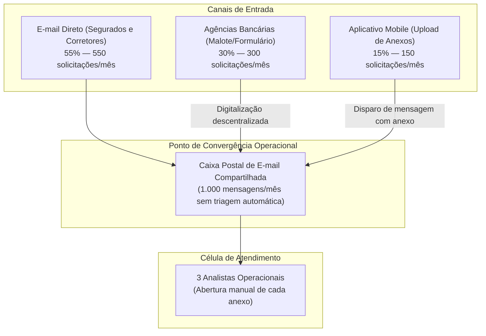
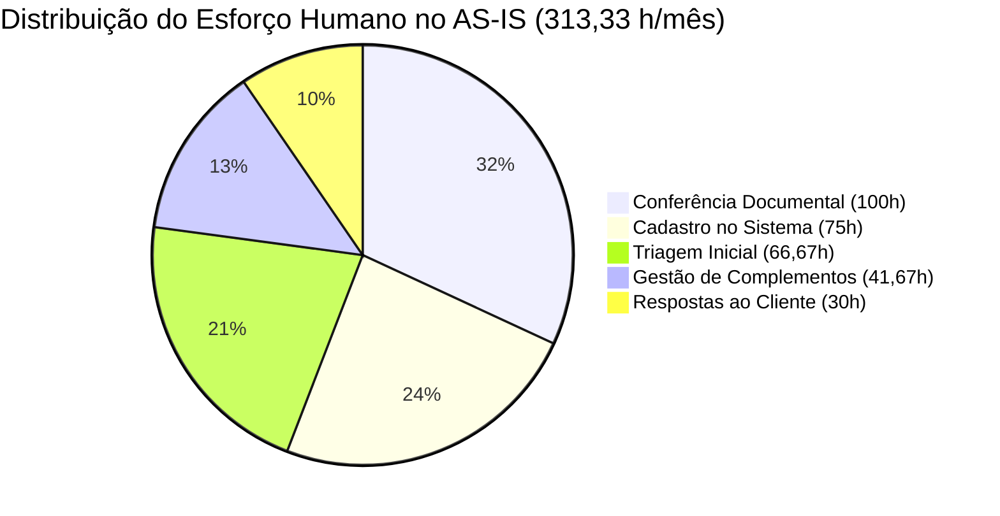

# Diagnóstico Operacional AS-IS e Análise de Esforço

> [!IMPORTANT]
> **Aviso Institucional:** Estudo independente elaborado para fins educacionais e de demonstração técnica em engenharia de dados e processos. Não constitui auditoria interna ou documento oficial de seguradora ou instituição financeira.

---

## 1. Contexto e Panorama da Operação Atual

O processo de alteração de beneficiários em apólices individuais de seguro de pessoas físicas (PF) é o procedimento operacional por meio do qual o segurado titular atualiza ou redistribui as porcentagens de indenização destinadas a seus beneficiários legais em caso de ocorrência de sinistro coberto.

### 1.1 Volumetria e Equipe
- **Volume Mensal Médio:** 1.000 solicitações de alteração de beneficiários.
- **Tamanho da Equipe:** 3 analistas de operações dedicados exclusivamente a este fluxo.
- **Expectativa de Crescimento:** 10% ao ano, impulsionada pela expansão da carteira de seguros e campanhas comerciais.
- **Capacidade Nominal da Equipe:** Considerando jornada de 160 horas úteis mensais por profissional, a célula dispõe de 480 horas brutas disponíveis/mês.

### 1.2 Nível de Serviço e Cumprimento Histórico
- **SLA Interno Estabelecido:** 5 dias úteis/corridos para processamento e encerramento.
- **Desempenho Histórico:**
  - **No Prazo:** 62% das solicitações (620 casos/mês).
  - **Fora do Prazo (Atraso):** **38% das solicitações (380 casos/mês)**.

---

## 2. Canais de Entrada e Ponto de Convergência

As solicitações chegam à seguradora por três portas de entrada com características distintas:

- **E-mail (55% — 550 solicitações/mês):** Texto livre enviado diretamente por clientes ou corretores, frequentemente com redações ambíguas e anexos múltiplos em diversos formatos (.pdf, .jpg, .heic).
- **Agências (30% — 300 solicitações/mês):** Formulários impressos preenchidos à mão pelo titular ou gerente da agência, digitalizados em scanners locais e transmitidos por e-mail para a central.
- **Aplicativo (15% — 150 solicitações/mês):** Carga inicial de dados pelo app que, por falta de integração direta com o backend de validação de seguros, encaminha um e-mail estruturado com anexo para a mesma caixa postal compartilhada.

**O Problema da Caixa Compartilhada:** Todos os canais convergem para a mesma caixa postal. O analista precisa inspecionar visualmente cada e-mail para saber se trata de uma nova solicitação, envio de documento que faltava, dúvida de corretor ou cobrança de status da agência.

---

## 3. Qualidade da Documentação e Retrabalho

Dois indicadores históricos caracterizam a complexidade documental da entrada:
1. **Inadequação Documental Inicial (~25% — 250 casos/mês):** Aproximadamente uma em cada quatro solicitações apresenta inconformidade inicial, como falta de certidões, ausência de documento oficial com foto do segurado ou beneficiário, documentos com corte ou ilegíveis.
2. **Espera Prolongada por Complemento (100 casos/mês):** Um contingente médio de 100 solicitações mensais permanece parado por mais de 5 dias em compasso de espera por retorno do cliente ou da agência com os documentos faltantes.

> [!NOTE]
> **Rigor Conceitual:** Os 25% de inadequação documental na entrada (250 casos) e as 100 solicitações em espera prolongada não constituem populações idênticas. Parte das 250 solicitações é resolvida rapidamente em poucos dias, enquanto os 100 casos representam o saldo médio que se estende no tempo. A análise não estabelece relação de causalidade exclusiva entre a espera por documentos e a taxa de 38% de atraso geral, pois tempos de processamento e concorrência na fila também exercem influência direta.

---

## 4. Os Três Gargalos Principais

### Gargalo 1 — Entrada Inadequada e Retrabalho Crônico
- **Problema:** A entrada em texto livre e sem validação prévia permite que pedidos com CPFs com dígitos inválidos, somas de percentuais diferentes de 100% e anexos ilegíveis cheguem à mesa do analista. O analista é obrigado a redigir e-mails manuais cobrando retificações, gerando até 3 trocas de mensagens para o mesmo caso.
- **Impacto:** Desperdício de tempo em conferências infrutíferas e atrito na experiência do cliente.
- **Solução no TO-BE:** *Validação preventiva e estruturação obrigatória da solicitação na origem (Shift-Left).*

### Gargalo 2 — Triagem Manual e Ausência de Fila Priorizada
- **Problema:** Na caixa de entrada compartilhada, mensagens novas misturam-se com respostas antigas. Não há critério FIFO (primeiro a entrar, primeiro a sair) garantido, nem classificação automática por risco ou proximidade do vencimento de SLA. O analista perde tempo selecionando "qual e-mail abrir".
- **Impacto:** Solicitações antigas ficam ocultas sob novos e-mails, provocando acúmulo e estouro de prazos.
- **Solução no TO-BE:** *Orquestração centralizada de fila, classificação automática por estados e regras determinísticas de priorização.*

### Gargalo 3 — Rastreabilidade Limitada e Gestão Reativa de Prazos
- **Problema:** Inexistência de um identificador unificado (protocolo) correlacionando todas as mensagens de um mesmo caso. O relógio de SLA interno continua correndo mesmo quando o processo está parado aguardando o cliente enviar uma certidão. Os gestores só descobrem atrasos quando a Ouvidoria ou a agência cobra um posicionamento.
- **Impacto:** Distorção das métricas reais da equipe e impossibilidade de diagnosticar a fase exata em que o atraso ocorreu.
- **Solução no TO-BE:** *Geração imediata de protocolo rastreável, log append-only de eventos operacionais, pausa automatizada de SLA em pendências e dashboards de visibilidade.*

### Gargalos Complementares Identificados:
- **Comunicação Não Padronizada:** Cada analista redige orientações de complemento com texto próprio, gerando dúvidas no segurado.
- **Dependência Excessiva de Trabalho Braçal:** Digitação repetida de dados cadastrais no sistema de apólices, aumentando a propensão a falhas humanas de digitação.
- **Baixa Escalabilidade:** Um aumento de demanda de 10% a.a. exigirá imediatamente a contratação de novos analistas se o processo continuar estritamente manual.

---

## 5. Mapeamento do Esforço Operacional Humano no AS-IS

A tabela factual documentada na especificação do case decompõe o esforço humano direto despendido pelos 3 analistas ao longo de um mês:

| Atividade Operacional | Volume Mensal | Tempo Unitário | Esforço Total (Minutos) | Esforço Total (Horas) | Equivalente Decimal |
|---|---|---|---|---|---|
| **Triagem Inicial** (leitura de e-mail, identificação de apólice) | 1.000 casos | 4 min | 4.000 min | 66h40 | **66,67 h** |
| **Conferência Documental** (leitura visual de certidões, CPFs e anexos) | 1.000 casos | 6 min | 6.000 min | 100h00 | **100,00 h** |
| **Gestão de Complementos** (redação de e-mails de cobrança e triagem de retornos) | 250 casos | 10 min | 2.500 min | 41h40 | **41,67 h** |
| **Cadastro no Sistema de Seguros** (digitação das alterações no sistema core) | 900 casos | 5 min | 4.500 min | 75h00 | **75,00 h** |
| **Respostas e Comunicações Finais** (envio de e-mail de confirmação ou recusa) | 900 casos | 2 min | 1.800 min | 30h00 | **30,00 h** |
| **TOTAL GERAL DA OPERAÇÃO** | — | — | **18.800 min** | **313h20** | **313,33 horas/mês** |

---

## 6. Distinção Metodológica Fundamental: Esforço Humano vs Lead Time

> [!IMPORTANT]
> **Esforço Humano Ativo (313,33 horas/mês):** Representa estritamente o tempo de trabalho em que os analistas estão interagindo ativamente com as solicitações (digitando, lendo, redigindo).
>
> **Lead Time (Tempo de Ciclo do Processo):** É o tempo transcorrido no relógio desde o momento em que o segurado envia a solicitação até a efetivação cadastral final. O lead time é composto por:
> - Tempo de fila (esperando na caixa postal);
> - Tempo de esforço ativo do analista;
> - Tempo de espera pelo cliente (em casos de complemento documental);
> - Tempo de concorrência operacional.
>
> **Conclusão:** Reduzir o esforço humano ativo de 313,33 horas para patamares menores alivia a equipe operacional e elimina gargalos internos, mas a redução do lead time percebido pelo cliente depende igualmente da agilidade do segurado no envio de pendências e da pontualidade das confirmações cadastrais.
