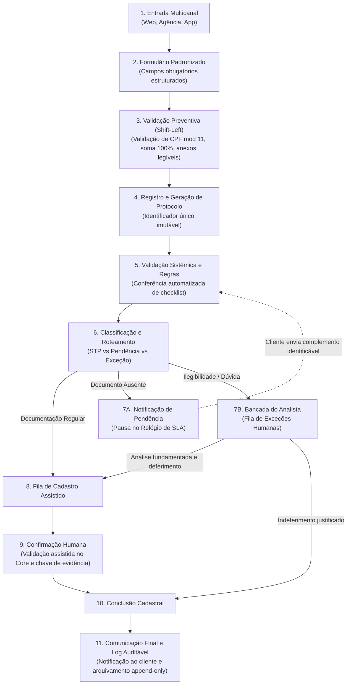
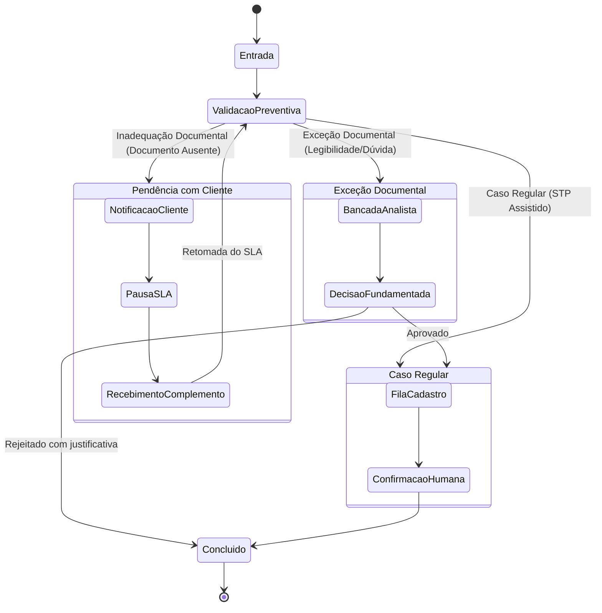

# Proposta TO-BE — Processo Estruturado, Rastreável e Automatizado

> [!IMPORTANT]
> **Aviso Institucional:** Estudo independente elaborado para fins educacionais e de demonstração técnica em engenharia de dados e processos. Não constitui especificação técnica homologada por instituição bancária ou seguradora.

---

## 1. Princípio Fundamental de Engenharia de Processos

O redesenho operacional para alteração de beneficiários orienta-se pela premissa:

> **"Antes de automatizar, é necessário estruturar, controlar e tornar o processo rastreável."**

Automatizar um processo desordenado resulta unicamente na aceleração de erros e na multiplicação de retrabalho. Portanto, a transformação TO-BE prioriza a criação de barreiras preventivas, padronização de dados, segregação de filas e garantia de auditoria contínua.

---

## 2. O Fluxo Operacional TO-BE em 11 Etapas

A jornada de uma solicitação foi remodelada em um ciclo de vida composto por 11 etapas orquestradas:

### Detalhamento das Etapas:

1. **Entrada Multicanal:** Preserva as três origens de demanda (Segurados/Corretores, Agências Bancárias e Aplicativo), mas elimina a caixa de e-mail desordenada como porta de entrada.
2. **Formulário Padronizado:** Coleta dados em schema rigoroso: dados do titular, apólice de referência e lista de beneficiários com vínculo familiar, data de nascimento e percentual de participação.
3. **Validação Preventiva (*Shift-Left*):** O formulário intercepta erros antes do envio:
   - Validação algorítmica dos dois dígitos verificadores de CPF (módulo 11);
   - Verificação exata da soma das participações (bloqueio se $\sum \neq 100,00\%$);
   - Validação de formato de e-mail e presença de anexos obrigatórios.
4. **Registro e Geração de Protocolo:** Criação instantânea de um identificador unificado e imutável (ex: `PROT-2026-XXXXX`), associando todos os eventos futuros àquele protocolo.
5. **Validação Sistêmica:** Motor de regras confere o checklist documental e a integridade da solicitação em memória.
6. **Classificação e Roteamento:** Direcionamento determinístico da solicitação para uma das filas operacionais especializadas.
7. **Gestão Operacional e Tratamento de Exceções:** Fila com priorização dinâmica orientada pelo prazo restante de SLA e criticidade da ocorrência.
8. **Cadastro Assistido:** Interface otimizada que apresenta ao analista os dados validados prontos para inclusão no sistema de apólices, reduzindo a digitação manual de 5 para 2 minutos.
9. **Confirmação Humana:** Exigência de ação expressa do analista informando a chave de evidência da transação executada no core securitário.
10. **Conclusão Cadastral:** Fechamento oficial do ciclo transacional e parada definitiva do relógio de SLA operacional.
11. **Comunicação Final e Histórico Auditável:** Disparo de e-mail padronizado de confirmação ao segurado e gravação do registro permanente no histórico de auditoria.

---

## 3. Os Três Caminhos Operacionais

### 3.1 Caminho 1: Caso Regular (STP Assistido — 75% da Demanda Modelada)
Ocorre quando todos os documentos estão legíveis, completos e validados. O processo dispensa triagem e conferência humana inicial, sendo disponibilizado diretamente na fila de cadastro para confirmação rápida pelo analista.

### 3.2 Caminho 2: Exceção Documental (Bancada do Analista — 6% da Demanda Modelada)
Casos com documentos com rasura, legibilidade duvidosa ou certidões que exijam validação jurídica de parentesco são direcionados à **Bancada do Analista**. O analista avalia o contexto, registra parecer fundamentado e delibera (aprova para cadastro ou rejeita).

### 3.3 Caminho 3: Complemento Necessário (Aguardando Cliente — 19% da Demanda Modelada)
Quando falta um anexo essencial (ex: certidão de casamento para comprovação de cônjuge), o sistema gera automaticamente uma notificação estruturada ao cliente indicando precisamente o documento ausente. O protocolo é colocado no estado `Aguardando Complemento` e o **relógio de SLA é pausado**.

---

## 4. O Papel Humano Indispensável: *Human-in-the-Loop*

> [!CAUTION]
> **Atenção:** A proposta TO-BE não elimina o julgamento humano nem preconiza automação integral não supervisionada (*unattended*). Alterações de beneficiários possuem implicações legais e securitárias diretas sobre direitos sucessórios e securitários.

### Atribuições Exclusivas do Analista Humano no TO-BE:
- **Análise de Documentos Limítrofes:** Avaliação de certidões antigas, documentos com carimbos ilegíveis ou declarações manuscritas.
- **Tratamento de Exceções de Negócio:** Resolução de impasses relativos a menores sob guarda judicial, tutelas e procurações públicas.
- **Solicitação de Complementos Fundamentados:** Emissão de pedidos de retificação quando houver discrepância jurídica não capturada pelo motor automático.
- **Aprovações e Rejeições Deliberadas:** Exercício da autoridade de aceitar ou recusar a alteração, com registro de justificativa auditável.
- **Confirmação de Efetivação Cadastral:** Verificação e validação do registro no sistema legado, garantindo que nenhum protocolo seja encerrado sem que a alteração tenha ocorrido de fato.

---

## 5. Política de SLA e Registro Rastreável de Eventos

### 5.1 Regras de Nível de Serviço (SLA)
- **Prazo Estabelecido:** 5 dias (120 horas nominais).
- **Relógio de Tempo Ativo Líquido:** O sistema calcula a duração do processo medindo estritamente as horas em que a solicitação esteve sob responsabilidade da seguradora:
  $$\text{Tempo Líquido de SLA} = \text{Tempo Total Transcorrido} - \sum \text{Intervalos de Pausa por Pendência}$$
- **Premissa Provisória de Pausa:** O relógio de SLA é pausado no instante exato da emissão da notificação de complemento.
- **Premissa Provisória de Retomada:** O relógio é retomado assim que um novo anexo ou mensagem com identificação inequívoca de protocolo é recebido no sistema.

### 5.2 Marco de Conclusão do SLA
- O encerramento do prazo regulatório de SLA ocorre no momento da **confirmação humana da alteração cadastral** (Etapa 9).
- A etapa de comunicação final ao cliente (Etapa 11) é gerenciada e monitorada como um fluxo assíncrono independente. Eventuais falhas em servidores SMTP ou atrasos de rede não reabrem o SLA cadastral da solicitação, permanecendo rastreadas em fila própria de mensageria (*Outbox pattern*).

### 5.3 Histórico de Eventos Append-Only
Todas as ações operacionais gravam uma trilha permanente de auditoria:
- Data/hora precisa do evento (UTC/local);
- Usuário (analista ou sistema automatizado);
- Estado anterior e novo estado da solicitação;
- Motivo da transição e evidências associadas;
- Payload imutável dos dados submetidos na versão.

> [!NOTE]
> Os parâmetros exatos de contagem de prazo (dias úteis bancários vs dias corridos, horário de corte das 18h e feriados nacionais) constituem definições que devem ser formalmente validadas com a área jurídica e de compliance antes de qualquer implantação corporativa em produção.
