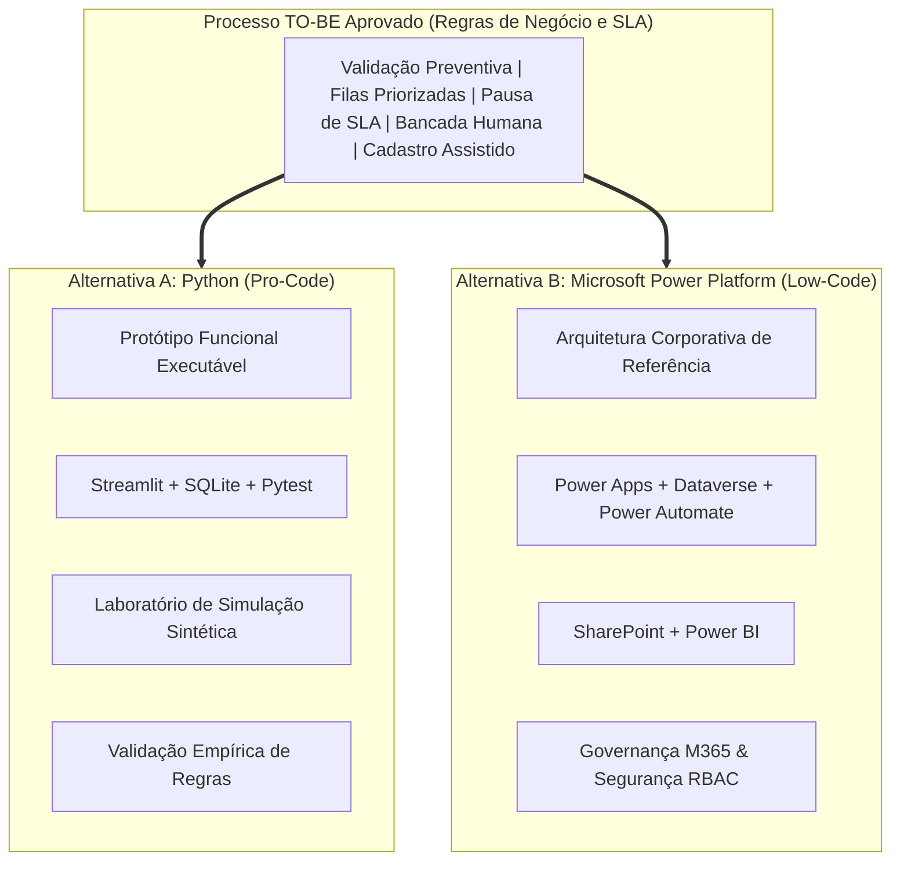

# Um Mesmo TO-BE. Duas Alternativas de Implementação.

> [!IMPORTANT]
> **Aviso Institucional:** Projeto independente, educacional e demonstrativo. Não constitui solução oficial ou homologada por instituição financeira ou pela Microsoft.
>
> **Princípio Arquitetural:** As abordagens apresentadas abaixo são **alternativas tecnológicas independentes e completas em si mesmas**. A Alternativa A (Python) não é obrigatoriamente uma fase preliminar da Alternativa B (Power Platform), nem a Alternativa B é uma evolução compulsória da Alternativa A. Ambas compartilham e validam a mesma especificação funcional do processo TO-BE aprovado sob perspectivas de engenharia distintas.

---

## 1. Visão Geral das Duas Alternativas

A modernização do processo de alteração de beneficiários foi explorada sob dois paradigmas tecnológicos consagrados na indústria de tecnologia bancária:

---

## 2. Alternativa A — Python (Pro-Code)

### 2.1 Posicionamento e Status
- **Status:** **Protótipo funcional plenamente implementado, testado e publicado**.
- **Repositório Oficial:** [github.com/pedro-caputo/case-dados-automacao-beneficiarios](https://github.com/pedro-caputo/case-dados-automacao-beneficiarios)
- **Finalidade:** Servir como bancada de testes algorítmicos, validação prática do fluxo operacional interativo e laboratório estatístico de estresse com 1.000 casos sintéticos controlados.

### 2.2 Tecnologias Verificadas no Repositório
- **Linguagem:** Python 3.10+ (desenvolvido e homologado em Python 3.14).
- **Interface de Usuário:** Streamlit multipágina (`app.py` e 6 módulos em `pages/`).
- **Camada de Dados:** SQLite relacional com esquema DDL normalizado e chaves estrangeiras ativas.
- **Manipulação de Dados:** Pandas para relatórios analíticos e consolidação de coortes.
- **Qualidade de Software:** Pytest com suíte de 35 testes automatizados cobrindo regras de negócio, persistência, cálculo de SLA e regressão de telas.

### 2.3 Capacidades e Recursos Demonstrados
1. **Nova Solicitação:** Formulário digital com crítica instantânea de CPF (módulo 11) e validação da soma dos percentuais (100,00%).
2. **Fila Operacional:** Painel visual com ordenação por proximidade de estouro de SLA e filtros por estado.
3. **Bancada do Analista:** Tela especializada para análise visual de documentos simulados, com botões de decisão fundamentada e registro de justificativa.
4. **Cadastro Assistido:** Tela de conciliação de dados pré-validados com botão de confirmação manual e geração de código de evidência.
5. **Dashboard Gerencial:** Métricas em tempo real de casos concluídos, casos pendentes e taxa de cumprimento de SLA.
6. **Laboratório Experimental:** Módulo executável de geração determinística de lote (semente `20261108`) com 1.000 intenções, processado em 0,221 segundo computacional.

### 2.4 Fronteira e Limitação Técnica
- O protótipo opera em **ambiente controlado com base de dados local SQLite**.
- A confirmação cadastral é validada e persistida internamente no banco demonstrativo; **não existe integração real comprovada com o sistema core de apólices legado** (mainframe/AS400).

---

## 3. Alternativa B — Microsoft Power Platform (Low-Code)

### 3.1 Posicionamento e Status
- **Status:** **Arquitetura corporativa de referência detalhadamente documentada**.
- **Repositório Oficial:** [github.com/pedro-caputo/case-beneficiarios-power-platform](https://github.com/pedro-caputo/case-beneficiarios-power-platform)
- **Finalidade:** Estabelecer o desenho de solução para ambientes bancários que já utilizam o ecossistema Microsoft 365, com foco em governança de dados, segurança corporativa (RBAC), auditoria em Dataverse e observabilidade executiva via Power BI.

### 3.2 Componentes e Tecnologias da Solução
- **Power Apps (Model-Driven App):** Interface corporativa responsiva para os analistas operacionais, com telas dedicadas para triagem, bancada de exceções e conferência de cadastro assistido.
- **Microsoft Dataverse:** Camada de persistência relacional com **modelo de dados formal de 19 tabelas customizadas** (`bpf_*`), provendo integridade referencial, bloqueio de concorrência (*optimistic locking*) e trilhas nativas de auditoria.
- **Power Automate:** **9 cloud flows documentados** (F01 a F09) para ingestão automatizada de e-mails, validação preventiva, orquestração de filas, disparos de notificações com tokens únicos e controle do cronômetro de SLA.
- **SharePoint Online:** Repositório seguro para guarda dos anexos e certidões, estruturado em pastas automáticas segregadas por protocolo.
- **Power BI:** Painel analítico de observabilidade corporativa comparando indicadores históricos (AS-IS) com métricas projetadas (TO-BE).

### 3.3 Capacidades e Recursos Documentados
1. **Matriz de Segurança e Perfis:** Segregação de funções entre *Analista de Operações*, *Supervisor/Gestor*, *Auditor* e *Identidade de Serviço (Service Principal)*.
2. **Padrão Outbox Transacional:** Garantia de que disparos de notificações e integrações externas ocorram de forma assíncrona desacoplada, sem falhas de transação no banco.
3. **Mockups Ilustrativos de Interface:** 8 telas conceituais que materializam a experiência visual do analista dentro da suíte Microsoft.
4. **Governança e ALM:** Especificação de soluções gerenciadas/não gerenciadas e ciclo de vida via Azure DevOps / GitHub Actions.

### 3.4 Fronteira e Limitação Técnica
- **Não existem componentes Power Platform implantados em um tenant corporativo real**.
- Trata-se de uma **especificação de engenharia de software e arquitetura de referência**, respaldada por mockups e esquemas conceituais, sem execução em nuvem Microsoft ativa.

---

## 4. Matriz Comparativa Detalhada: Python vs Power Platform

| Dimensão de Análise | Alternativa A — Python (Pro-Code) | Alternativa B — Microsoft Power Platform (Low-Code) |
|---|---|---|
| **Objetivo Central** | Provar empiricamente regras de negócio, conciliação e simulação em lote | Estabelecer a arquitetura corporativa para implantação corporativa governada |
| **Tecnologias Principais** | Python 3, Streamlit, SQLite, Pandas, Pytest | Power Apps, Dataverse, Power Automate, SharePoint, Power BI |
| **Estado de Desenvolvimento** | **Protótipo funcional executável e testado** | **Arquitetura de referência documentada com mockups** |
| **Demonstração Funcional** | Aplicação web interativa navegável localmente | Mockups conceituais ilustrativos e especificações de fluxo |
| **Camada de Persistência** | SQLite local normalizado com chaves estrangeiras | Microsoft Dataverse (19 tabelas `bpf_*` normalizadas) |
| **Segurança e Acesso** | Isolamento de universos e validação em camada de código | RBAC nativo Microsoft Entra ID (Azure AD), Unidades de Negócio e Roles |
| **Integração com Legado** | Mock de barramento assíncrono com chave de evidência manual | Conectores certificados, Custom APIs Dataverse ou Azure Integration Services |
| **Implantação Operacional** | Contêiner Docker, VM Linux ou servidor on-premise | Ambientes Microsoft Power Platform (Dev/HML/PRD) gerenciados |
| **Dependências Externas** | Interpretador Python e bibliotecas de código aberto (MIT) | Licenciamento corporativo Microsoft (Power Apps Premium, Dataverse capacity) |
| **Governança e Auditoria** | Tabela `eventos_historico` com inserção append-only | Auditoria nativa Dataverse + tabela de log transacional imutável |
| **Possibilidades Futuras** | Evolução para microsserviço containerizado em Kubernetes com FastAPI | Implementação direta no tenant corporativo via importação de Solution |

---

## 5. Síntese Estratégica para Decisão Corporativa

A coexistência dessas duas alternativas oferece valor técnico complementar a qualquer comitê de arquitetura e tecnologia:
- A **Alternativa A** responde com precisão matemática às perguntas: *"As regras de negócio funcionam? Qual é o comportamento do processo sob estresse de 1.000 solicitações? Quanto esforço operacional ativo pode ser poupado?"*
- A **Alternativa B** responde com rigor estrutural às perguntas: *"Como esse processo se integra ao ecossistema corporativo existente? Como tratar segregação de funções, retenção documental e governança de dados na nuvem corporativa?"*

