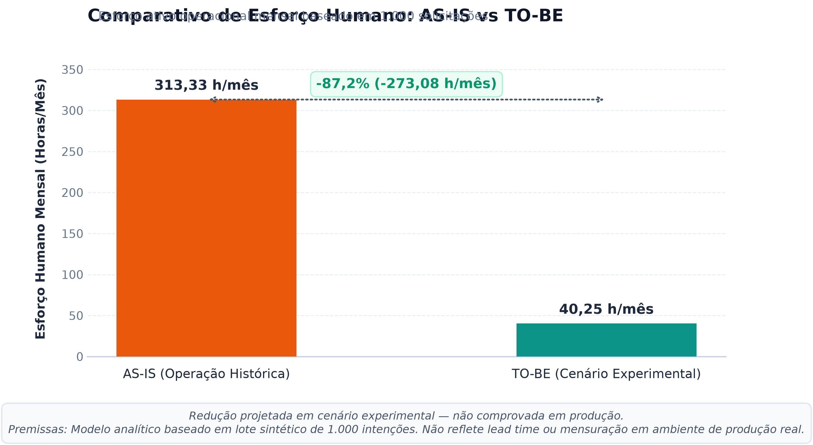
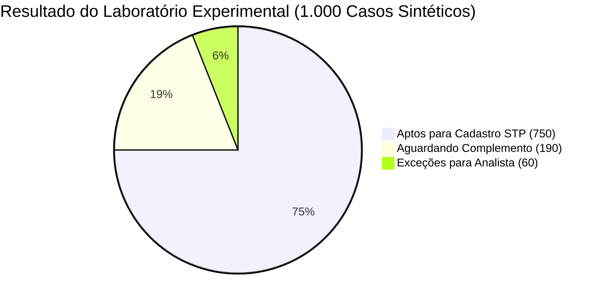

# Metodologia Experimental, Resultados e Análise Comparativa de Esforço

> [!IMPORTANT]
> **Aviso Institucional:** Projeto independente, educacional e demonstrativo. Os dados e métricas deste documento resultam de modelagem analítica e execução experimental em ambiente sintético controlado. Não constituem medições reais de produtividade coletadas em sistemas de produção bancária.

---

## 1. Quanto Esforço Podemos Evitar — e Sob Quais Premissas?

O principal objetivo analítico da modelagem TO-BE foi estimar o potencial de desoneração da equipe operacional decorrente da eliminação de triagens manuais, interceptação preventiva de erros e estruturação das filas de trabalho.

### Síntese Numérica do Esforço Mensal:
- **Baseline Histórico AS-IS:** **313,33 horas/mês** (313h20 | 18.800 minutos) consumidas pelos 3 analistas.
- **Cenário Experimental TO-BE:** **40,25 horas/mês** (40h15 | 2.415 minutos) de esforço humano residual projetado.
- **Diferença Projetada:** **273,08 horas/mês evitadas** na célula operacional.
- **Redução Modelada de Esforço Operacional:** **-87,2%**.

---

## 2. Gráfico Comparativo de Esforço Operacional

Abaixo apresenta-se a comparação em escala direta do esforço humano ativo mensal entre o processo histórico e o modelo experimental:

> [!NOTE]
> *Legenda Oficial do Gráfico:* **“Redução projetada em cenário experimental — não comprovada em produção.”**

---

## 3. Decomposição Metodológica das Duas Estimativas

### 3.1 Composição do Esforço Histórico AS-IS (313,33 h/mês)
O baseline oficial fundamenta-se nos 18.800 minutos factuais descritos no diagnóstico:

$$\text{Esforço AS-IS} = \frac{(1.000 \times 4) + (1.000 \times 6) + (250 \times 10) + (900 \times 5) + (900 \times 2)}{60} = \frac{18.800}{60} = 313,33 \text{ h/mês}$$

- **Triagem:** $1.000 \times 4\text{ min} = 4.000\text{ min}$ (66,67 h)
- **Conferência documental:** $1.000 \times 6\text{ min} = 6.000\text{ min}$ (100,00 h)
- **Gestão de complementos:** $250 \times 10\text{ min} = 2.500\text{ min}$ (41,67 h)
- **Cadastro manual no sistema:** $900 \times 5\text{ min} = 4.500\text{ min}$ (75,00 h)
- **Respostas ao segurado/agência:** $900 \times 2\text{ min} = 1.800\text{ min}$ (30,00 h)

### 3.2 Composição do Esforço Projetado no TO-BE Experimental (40,25 h/mês)
O cenário modelado no protótipo Python recalcula o tempo humano ativo com base nas novas regras de automação:

$$\text{Esforço TO-BE} = \frac{(60 \times 15) + (750 \times 2) + 15}{60} = \frac{900 + 1.500 + 15}{60} = \frac{2.415}{60} = 40,25 \text{ h/mês}$$

| Atividade no TO-BE | Volume de Casos | Tempo Unitário | Minutos Totais | Horas Totais | Justificativa do Modelo |
|---|---|---|---|---|---|
| **Triagem Inicial** | 1.000 casos | 0 min | 0 min | 0,00 h | Totalmente automatizada via motor de regras digital |
| **Notificação de Complemento** | 190 casos | 0 min | 0 min | 0,00 h | Notificação padronizada automática disparada na ingestão |
| **Análise de Exceções Humanas** | 60 casos | 15 min | 900 min | 15,00 h | Tempo qualificado dedicado à Bancada do Analista |
| **Efetivação de Cadastro Assistido** | 750 casos | 2 min | 1.500 min | 25,00 h | Dados pré-validados apresentados em tela; analista apenas confirma |
| **Comunicação Final de Conclusão** | 1.000 casos | 0 min | 0 min | 0,00 h | Mensageria assíncrona automatizada com comprovante em PDF |
| **Auditoria e Monitoramento Residual** | Lote mensal | — | 15 min | 0,25 h | Supervisão periódica de fila e controle de qualidade |
| **TOTAL TO-BE EXPERIMENTAL** | — | — | **2.415 min** | **40,25 h/mês** | **Redução de 87,2% em relação a 313,33 h** |

---

## 4. Evidências Empíricas do Protótipo Python

Os números acima não decorrem de meras suposições teóricas, tendo sido testados e validados no protótipo executável através de dois modos operacionais:

### 4.1 Rodada Interativa Documentada (3 Casos Ponta a Ponta)
Com o objetivo de validar o funcionamento da máquina de estados e o isolamento dos registros:
- **Caso 1 (Caminho Regular):** Dados e documentos regulares submetidos → Validação sistêmica aprovada → Encaminhado para cadastro assistido → Analista confirmou alteração → Protocolo concluído e notificado.
- **Caso 2 (Caminho de Inadequação):** Documento obrigatório ausente → Interceptado na validação → Estado `Aguardando Complemento` atribuído → Relógio de SLA pausado.
- **Caso 3 (Exceção Documental):** Imagem ilegível na certidão → Encaminhado para a `Bancada do Analista` → Analista examinou, emitiu parecer fundamentado e deferiu com ressalva.
- **Conclusão:** 3 solicitações criadas, 2 concluídas e 1 mantida sob análise humana especializada.

### 4.2 Laboratório Experimental (Simulação em Lote de 1.000 Casos)
Execução da semente determinística `seed = 20261108` simulando a distribuição de canais do case:
- **Canais Ingestados:** 550 por E-mail (55%), 300 por Agência (30%) e 150 pelo Aplicativo (15%).
- **Resultado da Classificação pelo Motor de Regras:**
  - **750 casos (75,0%):** Classificados como *Aptos para Cadastro* (Straight-Through Processing Assistido).
  - **190 casos (19,0%):** Classificados como *Aguardando Complemento* (ausência de anexo obrigatório) com pausa imediata de SLA.
  - **60 casos (6,0%):** Classificados como *Exceção para a Bancada do Analista* (legibilidade duvidosa ou divergência de parentesco).
  - *Soma rigorosa das três categorias:* $750 + 190 + 60 = 1.000\text{ solicitações}$.

### 4.3 Indicador Adicional: 77 Erros Sintéticos Prevenidos
Durante a submissão das intenções, o motor de validação preventiva (*Shift-Left*) interceptou **77 erros cadastrais e matemáticos**:
- Dígitos verificadores incorretos de CPF calculados pelo algoritmo do módulo 11;
- Propostas com soma de percentuais de beneficiários divergente de 100,00% (ex: 90% ou 105%);
- E-mails com padrão sintático inválido.

> [!IMPORTANT]
> **Distinção Estatística:** Estes 77 erros prevenidos referem-se a tentativas de envio bloqueadas na origem. Eles **não representam uma quarta categoria** no universo dos 1.000 casos do lote, mas uma métrica complementar da eficácia dos validadores digitais.

### 4.4 Desempenho Computacional do Algoritmo: 0,221 Segundo
Na execução registrada no laboratório, a CPU local consumiu **0,221 segundo** para processar as 1.000 intenções, validar os schemas e persistir as linhas no banco relacional (~4.534 registros/segundo).

> [!CAUTION]
> **Ressalva de Desempenho:** Esse indicador mede estritamente **desempenho computacional em memória/disco local**. Ele **não significa que 1.000 clientes reais seriam atendidos em 0,221 segundo**, e não deve ser apresentado como medida de produtividade operacional do atendimento humano.

---

## 5. Ressalvas Metodológicas Obrigatórias

Para assegurar integridade técnica e transparência analítica perante bancas de avaliação e comitês de governança:

1. **Origem dos Dados:** A redução de 87,2% pertence exclusivamente ao **cenário experimental simulado no protótipo Python**, baseando-se nas premissas modeladas na semente `20261108`.
2. **Estudo de Tempos e Métodos:** O tempo residual estimado de 2 minutos para efetivação de cadastro assistido e 15 minutos para análise de exceções necessita de cronometragens empíricas (*time study*) em ambiente operacional corporativo real.
3. **Ausência de Integração Legada:** O protótipo demonstra o fluxo com persistência demonstrativa local; não houve conexão física a barramentos de mensageria (Kafka/MQ) ou APIs do sistema core legado de seguros.
4. **Cumprimento Efetivo de SLA:** A redução do esforço manual mitiga sobrecarga e filas internas, mas **não comprova matematicamente que o índice de cumprimento de SLA saltará de 62% para 100%**, dado que atrasos causados pelo tempo de resposta do cliente dependem de fatores externos à seguradora.
5. **Independência das Soluções:** Os resultados de -87,2% não foram gerados pela Power Platform, que é uma especificação de arquitetura corporativa e não teve execução de lote sintético em nuvem.
