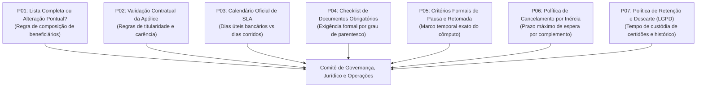
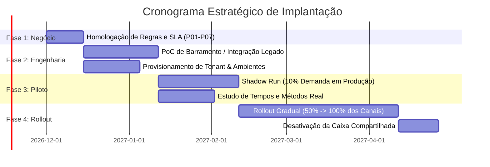

# Governança, Gestão de Riscos e Próximos Passos

> [!IMPORTANT]
> **Aviso Institucional:** Estudo independente elaborado para fins educacionais e de demonstração técnica em engenharia de dados e processos. Não constitui cronograma corporativo oficial de instituição bancária ou seguradora.

---

## 1. Visão Geral de Governança e Limitações Atuais

A maturidade de um projeto de engenharia de software e automação avalia-se tanto pela capacidade de gerar valor quanto pela lucidez com que reconhece suas fronteiras técnicas atuais.

### Limitações Consolidadas do Estado Atual:
- **Ausência de Integração Real com Core Legado:** Ambas as alternativas operam sem acoplamento direto com o mainframe securitário. A Alternativa A utiliza persistência local SQLite; a Alternativa B documenta os pontos de extensão e conectores sem implantação em tenant de produção.
- **Dados Exclusivamente Sintéticos:** Todas as apólices, CPFs, nomes e telefones foram gerados algoritmicamente (PRNG e Faker). Nenhuma informação de cliente real foi coletada, processada ou armazenada.
- **OCR e Validação Visual Simulados:** A qualidade de imagem (legível vs ilegível) foi modelada por semente estatística controlada, devendo ser substituída por serviços de Document AI em produção.
- **Cronômetro Contínuo vs Calendário Bancário:** O protótipo calculou horas corridas líquidas (120h = 5 dias); uma implantação corporativa exigirá matriz de feriados nacionais, estaduais e expediente bancário comercial.

---

## 2. Matriz de Riscos Técnicos e Operacionais

| Risco Identificado | Impacto | Probabilidade | Estratégia de Mitigação Proposta |
|---|---|---|---|
| **R1. Incompatibilidade com Sistemas Legados** Dificuldade de conectar APIs modernas com o core de seguros (mainframe). | Alto | Média | **Adoção do Cadastro Assistido:** Manter o analista operando com dados pré-conciliados em tela e registrando código de evidência manual até a disponibilização de barramento SOA/Kafka ou automação assistida. |
| **R2. Resistência à Adoção nos Canais** Agências e corretores insistindo no envio de e-mails em texto livre e sem anexo legível. | Médio | Alta | **Campanha de Transição e Canais Assistidos:** Implementar formulários digitais intuitivos com auto-preenchimento e criar regra de triagem automática que rejeita na entrada mensagens fora do padrão estruturado. |
| **R3. Conformidade Regulatória e LGPD** Exposição inadvertida de dados de beneficiários e herdeiros legais. | Crítico | Baixa | **Privacidade por Design (*Privacy by Design*):** Segregação estrita de funções via RBAC, trilha de auditoria append-only imutável, expurgo temporário de arquivos temporários e criptografia ponta a ponta (TLS 1.3 / AES-256). |
| **R4. Regras de Negócio Indefinidas** Divergência entre áreas sobre política de lista integral vs parcial. | Alto | Alta | **Modelo de Dados Versionado:** A arquitetura proposta foi desenhada para suportar snapshots completos de composição a cada revisão, adaptando-se a qualquer uma das decisões do comitê de produtos. |
| **R5. Falso Positivo em OCR / Document AI** Motor automático aprovar documento adulterado ou rejeitar certidão válida. | Médio | Média | **Human-in-the-Loop Obrigatório:** Casos de baixa confiança (*confidence score* inferior a 85%) são obrigatoriamente roteados para a Bancada do Analista humano. |

---

## 3. Políticas Corporativas Pendentes de Confirmação Formal

Antes de qualquer avanço para esteira de homologação ou produção, as seguintes definições de negócio e governança devem ser formalizadas com as áreas responsáveis:

1. **P01 — Composição de Beneficiários:** Definir se a alteração exige o envio da lista integral de todos os beneficiários vigentes ou se permite a inclusão/exclusão pontual com redistribuição proporcional.
2. **P02 — Validação de Apólice:** Definir o método de consulta em tempo real da apólice/certificado no sistema de seguros para confirmação de adimplência do segurado titular.
3. **P03 — Calendário de SLA:** Esclarecer se o prazo regulatório de 5 dias é contado em dias úteis com horário de corte (ex: 18h) ou dias corridos contínuos.
4. **P04 — Checklist Documental Oficial:** Homologar a lista oficial de documentos exigíveis para cada categoria (cônjuge, filhos menores, terceiros sem parentesco consanguíneo).
5. **P05 — Marco de Pausa e Retomada:** Confirmar juridicamente se a pausa do SLA é permitida a partir do disparo da notificação de pendência e retomada no momento exato da recepção de novo documento.
6. **P06 — Política de Inércia:** Definir prazo limite (ex: 30 dias corridos) para cancelamento automático de solicitações pendentes sem retorno do cliente.
7. **P07 — Ciclo de Vida Documental:** Formalizar tabela de temporalidade para expurgo ou arquivamento frio dos documentos digitalizados no SharePoint ou data lake.

---

## 4. Roteiro de Próximos Passos (Roadmap de Implantação)

Para transitar do estágio de validação e arquitetura conceitual para uma operação real segura, recomenda-se o cronograma estruturado em 4 fases sequenciais:

### Fase 1: Alinhamento e Homologação de Regras (Semanas 1 a 2)
- Realização de oficinas técnicas com Jurídico, Produtos de Seguros e Operações para responder formalmente às pendências P01 a P07.
- Emissão do Documento de Requisitos de Negócio (BRD) homologado.

### Fase 2: Engenharia e Conectividade (Semanas 3 a 6)
- **Cenário Low-Code:** Provisionamento do tenant corporativo Power Platform, criação das 19 entidades Dataverse e configuração dos 9 fluxos no Power Automate.
- **Cenário Pro-Code:** Empacotamento de microsserviço Python/FastAPI em contêiner Docker integrado à infraestrutura de nuvem corporativa.
- Desenvolvimento da camada de mensageria assíncrona ou conectores certificados com o mainframe de seguros.

### Fase 3: Operação Sombra (*Shadow Run*) e Calibragem (Semanas 7 a 10)
- Seleção de 10% das solicitações reais recebidas por agências piloto para processamento paralelo na nova plataforma.
- Realização de estudo empírico de tempos e métodos (*time study*) para mensurar com precisão cronométrica o tempo real de cadastro assistido e análise de exceções.
- Calibração dos limiares de acurácia de OCR/Document AI.

### Fase 4: Rollout Gradual e Sustentação (Semanas 11 a 18)
- Expansão progressiva do novo fluxo para 50% e subsequentemente 100% da volumetria mensal de seguros PF.
- Treinamento formal da célula de analistas na operação da Bancada do Analista e gestão visual de SLA.
- Desativação controlada da caixa de entrada de e-mail compartilhada como ponto de triagem manual.
