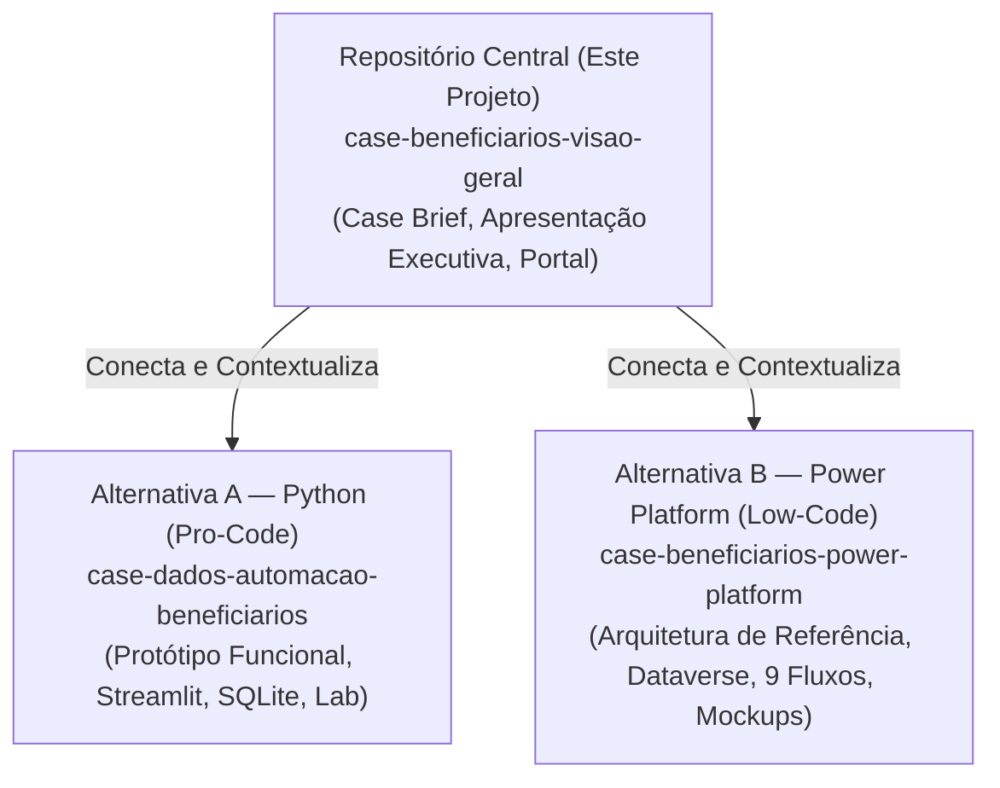

# Fontes Oficiais, Rastreabilidade e Registro de Decisões

> [!IMPORTANT]
> **Aviso Institucional:** Documento técnico de governança e rastreabilidade para auditoria acadêmica e institucional. Todos os artefatos, códigos e fontes citados derivam de projetos independentes elaborados para fins educacionais.

---

## 1. Fontes Primárias do Case de Dados e Automação

O projeto consolida conhecimentos e artefatos gerados ao longo de três repositórios complementares no GitHub:

### 1.1 Repositório Central (Portal Integrador)
- **Nome:** `case-beneficiarios-visao-geral`
- **URL Oficial:** [https://github.com/pedro-caputo/case-beneficiarios-visao-geral](https://github.com/pedro-caputo/case-beneficiarios-visao-geral)
- **Papel:** Apresentação executiva, consolidação de decisões, análise comparativa de alternativas, portal de acesso e guia de apresentação.

### 1.2 Alternativa A — Python (Protótipo Funcional)
- **Nome:** `case-dados-automacao-beneficiarios`
- **URL Oficial:** [https://github.com/pedro-caputo/case-dados-automacao-beneficiarios](https://github.com/pedro-caputo/case-dados-automacao-beneficiarios)
- **Papel:** Prova de conceito funcional executável, motor de validação algorítmica em memória, banco SQLite normalizado, laboratório determinístico de simulação (semente `20261108`) e 35 testes automatizados.

### 1.3 Alternativa B — Microsoft Power Platform (Arquitetura de Referência)
- **Nome:** `case-beneficiarios-power-platform`
- **URL Oficial:** [https://github.com/pedro-caputo/case-beneficiarios-power-platform](https://github.com/pedro-caputo/case-beneficiarios-power-platform)
- **Papel:** Especificação de arquitetura corporativa Low-Code para ambiente bancário M365/Dataverse, modelo relacional de 19 tabelas `bpf_*`, especificação de 9 cloud flows no Power Automate, matriz de segurança RBAC e 8 mockups funcionais.

---

## 2. Documentos de Referência Original

O desenvolvimento das duas soluções e a presente consolidação basearam-se no acervo de especificações factuais do case:

1. **`ESPECIFICACAO_PROTOTIPO(1).md` (Versão 1.0 — 08/11/2026):**
   - Definição da volumetria de 1.000 casos mensais e equipe de 3 analistas;
   - Distribuição histórica dos canais de entrada (55% e-mail, 30% agências, 15% app);
   - Baseline oficial de esforço humano de 18.800 minutos mensais (313h20);
   - Taxa de 38% de solicitações fora do SLA interno de 5 dias;
   - Regras de validação de CPF (módulo 11) e soma obrigatória de quotas em 100%.

2. **`Case_Dados_Automacao_PowerPoint.pptx`:**
   - Roteiro narrativo corporativo e identidade visual da apresentação executiva;
   - Estrutura de 11 slides consolidando o diagnóstico, a jornada TO-BE e a síntese de resultados.

3. **Artefatos e Logs do Protótipo Python:**
   - `data/raw_intents_1000.csv`: Lote bruto de intenções sintéticas gerado na semente `20261108`;
   - `tests/test_*.py`: 35 testes de unidade e regressão executados com sucesso no Pytest.

4. **Artefatos da Arquitetura Power Platform:**
   - `mockups/manifesto.json`: Especificação descritiva dos 8 mockups ilustrativos;
   - `diagramas/arquitetura.mmd` e `arquitetura.png`: Diagrama de componentes e integração.

---

## 3. Matriz de Rastreabilidade de Indicadores e Métricas

A tabela a seguir demonstra a consistência matemática e a rastreabilidade de todos os dados citados no projeto:

| Métrica / Indicador | Valor Consolidado | Fonte Primária | Validação no Protótipo |
|---|---|---|---|
| **Volume Mensal** | 1.000 solicitações | Especificação do Case | Lote sintético gerado com exatamente 1.000 registros |
| **Equipe Operacional** | 3 analistas | Especificação do Case | Baseline de dimensionamento para esforço de 313,33 h |
| **Crescimento Anual** | 10% ao ano | Especificação do Case | Parâmetro de escalabilidade da modelagem |
| **SLA Interno** | 5 dias | Especificação do Case | Regra de relógio ativo de 120h com pausas por pendência |
| **Cumprimento Histórico** | 62% no prazo / 38% atraso | Apresentação Executiva | Indicador de oportunidade de modernização do processo |
| **Distribuição de Canais** | 550 E-mail / 300 Agência / 150 App | Especificação do Case | Distribuição exata na semente `20261108` ($55\% + 30\% + 15\% = 100\%$) |
| **Esforço Humano AS-IS** | 313,33 h/mês (18.800 min) | Especificação do Case | Soma exata das 5 atividades operacionais mapeadas |
| **Esforço Humano TO-BE** | 40,25 h/mês (2.415 min) | Laboratório Python | Calculado a partir de $(60 \times 15) + (750 \times 2) + 15\text{ min}$ |
| **Redução Projetada** | -87,2% (-273,08 h/mês) | Laboratório Python | $(313,33 - 40,25) / 313,33 \times 100\% = 87,153\%$ |
| **Classificação Lote 1.000** | 750 STP / 190 Pendência / 60 Analista | Laboratório Python | $750 + 190 + 60 = 1.000$ casos classificados |
| **Erros Prevenidos** | 77 erros na origem | Laboratório Python | Métrica de validação de schema e CPF (indicador independente) |
| **Desempenho CPU** | 0,221 segundo | Execução Local Python | Medição de clock em processamento de memória/disco |

---

## 4. Registro de Divergências Documentais e Harmonização

Durante a inspeção das documentações históricas das Alternativas A e B, registraram-se pequenas divergências de representação que foram formalmente harmonizadas neste repositório central:

1. **Decomposição das Atividades do AS-IS:**
   - *Divergência:* Em alguns rascunhos antigos da documentação da Alternativa A, o esforço de triagem aparecia como $1.000 \times 5\text{ min} = 83,33\text{ h}$ e conferência como $1.000 \times 8\text{ min} = 133,33\text{ h}$, somando os mesmos 18.800 min com cadastro em 750 casos.
   - *Harmonização Aprovada:* Adotou-se rigorosamente a tabela oficial da especificação do case: Triagem ($1.000 \times 4 = 4.000\text{ min}$), Conferência ($1.000 \times 6 = 6.000\text{ min}$), Complementos ($250 \times 10 = 2.500\text{ min}$), Cadastro ($900 \times 5 = 4.500\text{ min}$) e Respostas ($900 \times 2 = 1.800\text{ min}$), totalizando os exatos 18.800 minutos (**313h20 = 313,33 horas**).

2. **Indicador de 77 Erros Prevenidos:**
   - *Divergência:* Risco de ser interpretado como parte integrante da soma dos 1.000 casos do lote.
   - *Harmonização Aprovada:* O indicador de 77 erros foi claramente segregado como métrica de eficácia da camada de validação preventiva (*Shift-Left*), mantendo a soma das categorias fechada em $750 + 190 + 60 = 1.000$ casos.

3. **Status de Implantação da Alternativa B (Power Platform):**
   - *Divergência:* Risco de os mockups serem interpretados por avaliadores desatentos como telas de um sistema em produção ativa.
   - *Harmonização Aprovada:* Registro categórico e explícito de que a Alternativa B é uma **arquitetura de referência documentada e ilustrada por mockups conceituais**, sem implantação real em tenant corporativo.

